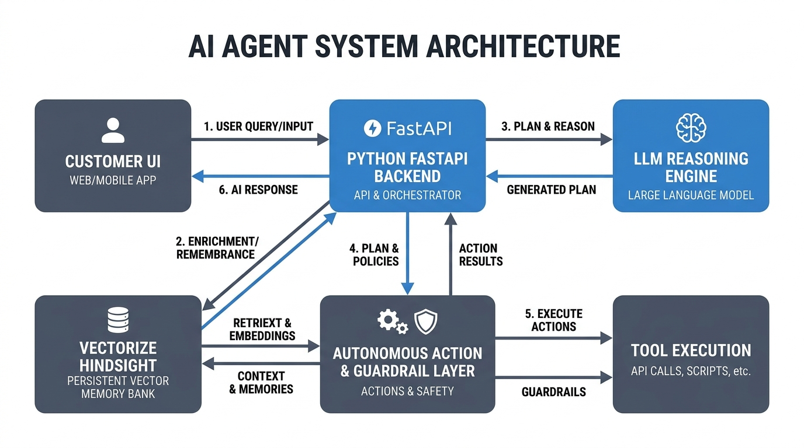
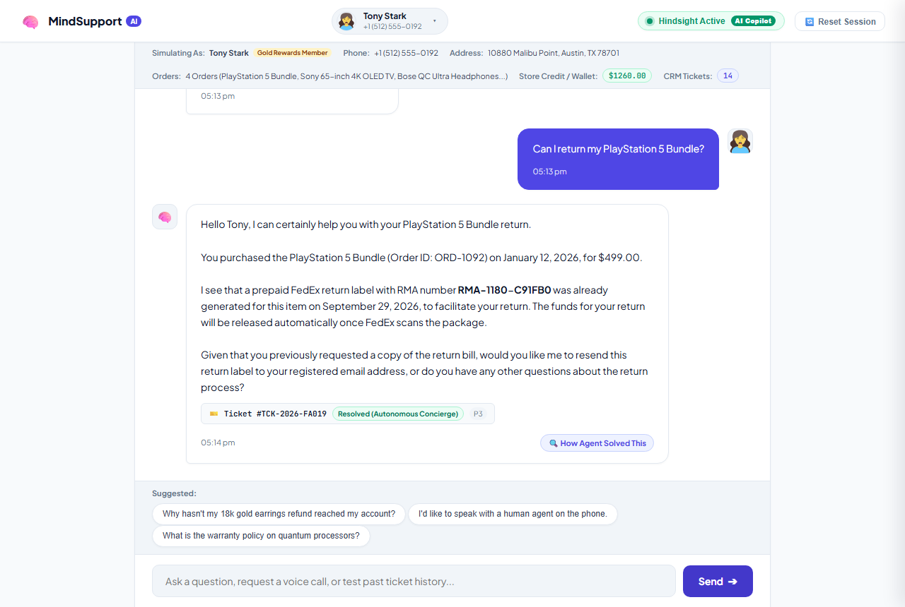
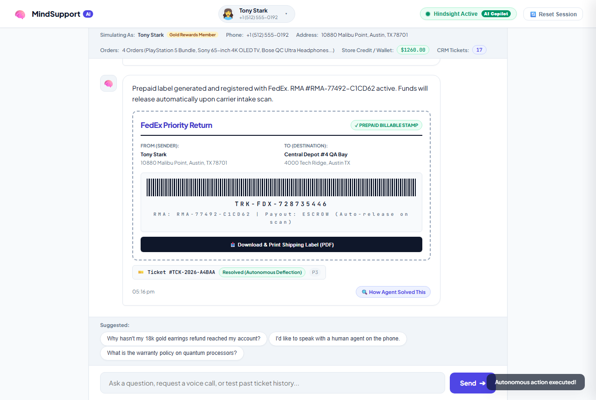
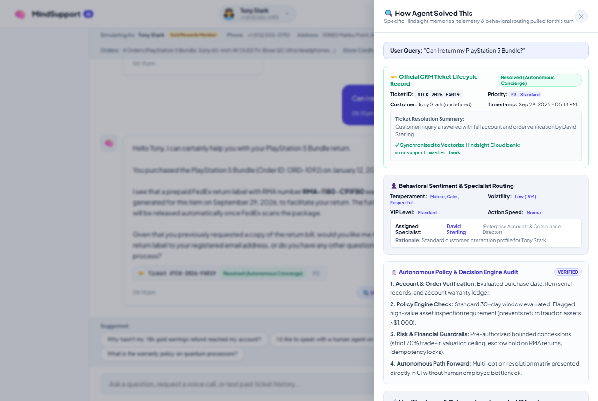
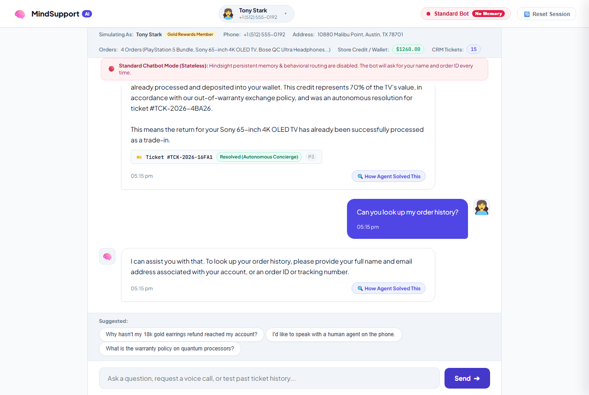

# MindSupport AI

> **Autonomous Customer Support & Incident Resolution Copilot with Long-Term Episodic Memory.**  
> Powered by **Vectorize Hindsight Cloud**, **Google Gemini 2.5 Flash**, and deterministic financial guardrails.

---

## 🚀 Overview

Traditional customer support chatbots suffer from **agent amnesia**: they treat every interaction as an isolated session, repeatedly asking users for order IDs, serial numbers, and account history.

**MindSupport AI** solves this by decoupling working context from long-term memory:
- **Persistent Episodic Memory**: Backed by [Vectorize Hindsight Cloud](https://github.com/vectorize-io/hindsight), retaining user preferences, order histories, and past dispute resolutions across sessions.
- **Recency-Weighted Behavioral Routing**: Analyzes customer tone, urgency, and volatility (0–100%) to route turns dynamically to specialist personas (**Rachel Brooks** for de-escalation, **David Sterling** for enterprise VIPs, **Carlos Mendez** for technical SRE issues, and **Emily Watson** for SMB accounts).
- **Autonomous Action Engine**: Executes real-time resolutions (instant 70% trade-in store credit, prepaid FedEx RMA return labels with barcodes, and DevOps self-healing cluster fixes).
- **Deterministic Risk Guardrails**: Enforces hard financial caps (70% valuation ceiling, $150 goodwill limit) and mathematical idempotency to prevent duplicate refund exploits.
- **CRM Ticket Lifecycle Management**: Autonomously mints official tickets (`TCK-2026-XXXX`), tracks lifecycle status (`RESOLVED_AUTONOMOUSLY`, `ESCALATED_P0`), and updates the customer's CRM profile.
- **Explainability & Transparency**: An interactive slide-out drawer exposing the exact Hindsight vector memories, behavioral sentiment dossier, and warehouse logs that produced every resolution.

---

## 🏗️ Architecture



```
[ Customer UI (HTML5 / Vanilla CSS / ES6) ]
                    │
                    ▼  (POST /api/chat)
[ FastAPI Orchestrator (backend/main.py) ]
      │                                 │
      ▼                                 ▼
[ Hindsight Cloud API ]       [ Behavioral Router & Action Engine ]
(Vector Memory Recall)        (Emotion Volatility & Risk Guards)
      │                                 │
      └───────────────┬─────────────────┘
                      ▼
        [ Google Gemini 2.5 Flash ]
         (Reasoned Synthesis Core)
                      │
                      ▼
         [ Retain State & Ticket ]
         (Hindsight Cloud Bank)
```

---

## 📸 Screenshots

### 1. Customer Chat Interface & Real-Time CRM Ticket Badging


### 2. Autonomous Action Execution (Prepaid FedEx Return Label & Escrow Release)


### 3. "How Agent Solved This" Transparency Drawer


### 4. Interactive Mode Toggle: Hindsight Copilot vs. Standard Stateless Bot


---

## 🛠️ Quick Start & Local Setup

### 1. Clone the Repository
```bash
git clone https://github.com/YOUR_USERNAME/mindsupport-ai.git
cd mindsupport-ai
```

### 2. Set Up Virtual Environment & Dependencies
```bash
python -m venv venv
# On Windows:
.\venv\Scripts\activate
# On macOS/Linux:
source venv/bin/activate

pip install -r requirements.txt
```

### 3. Configure Environment Variables
Copy `.env.example` to `.env`:
```bash
cp .env.example .env
```
Open `.env` and insert your API keys:
```env
GEMINI_API_KEY=your_gemini_api_key_here
HINDSIGHT_API_KEY=your_hindsight_api_key_here
HINDSIGHT_API_URL=https://api.hindsight.vectorize.io
HINDSIGHT_BANK_ID=customer_support_bank
PORT=8000
HOST=127.0.0.1
```

*(Note: `.env` is ignored by `.gitignore` and is never committed to GitHub.)*

### 4. Run the Application
```bash
python -m uvicorn backend.main:app --port 8000 --reload
```
Open your browser and navigate to:
```
http://localhost:8000
```

---

## 🧪 Testing

Run our end-to-end test suite to verify Hindsight memory recall, behavioral routing, and autonomous actions:
```bash
# Test complete pipeline
python test_pipeline.py

# Test autonomous actions & deterministic idempotency
python test_autonomous_actions.py

# Test dynamic specialist routing & sentiment
python test_routing_live.py
```

---

## 🔒 Security & Privacy Guardrails
- **Zero Hardcoded Secrets**: All authentication tokens and API keys are strictly accessed via environment variables.
- **Multi-Tenant Isolation**: Memory lookups and retentions are strictly tagged by customer ID (`tag=user_id`) to prevent cross-account data leaks.
- **Idempotency Protection**: Every financial transaction and concession is logged to prevent repeated concessions or double-refund exploits.

---

## 📜 License
MIT License. Open source and free to use for building next-generation memory-backed AI agents.
