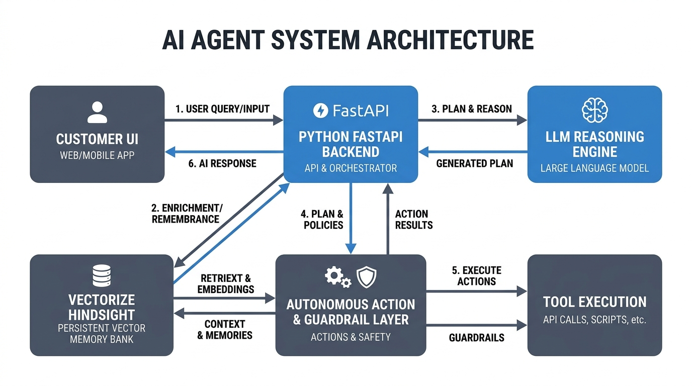
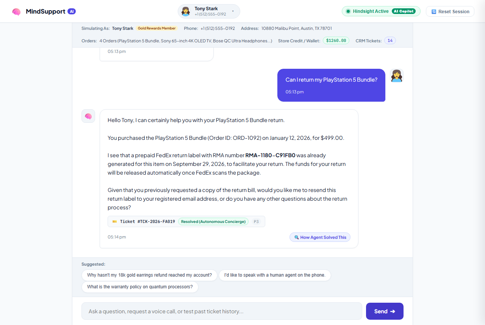
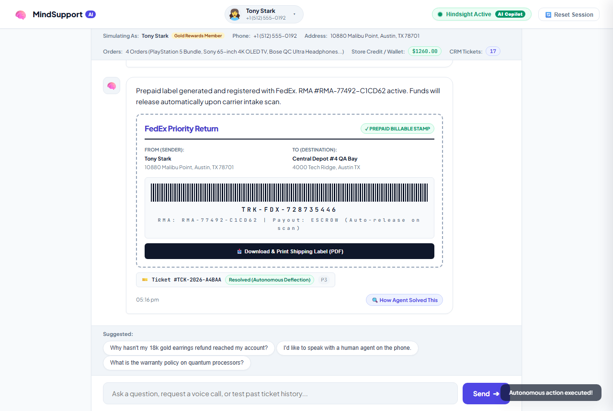
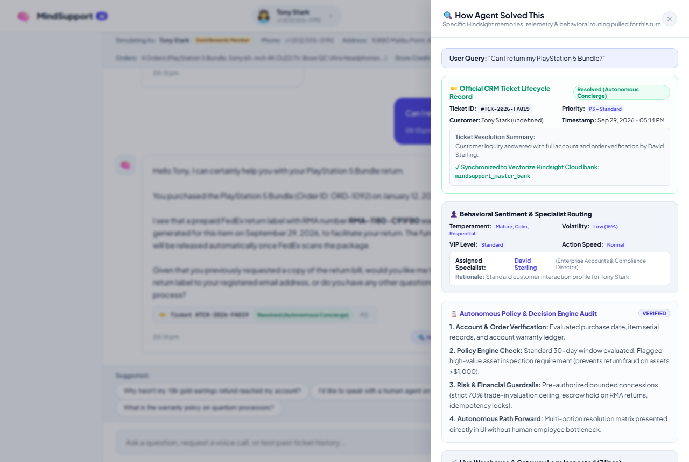
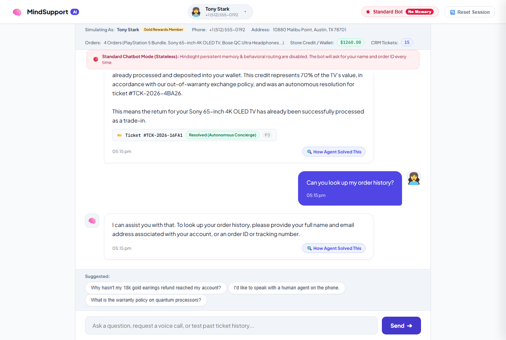

# Why My Agent Kept Forgetting Context Until Hindsight

A few weeks ago, I watched our support bot hand a customer a $100 goodwill refund. The customer said thanks, rephrased the exact same complaint ten seconds later, and the bot cheerfully handed them another $100.

Five minutes later, they had collected $400 in wallet credit. The bot was not broken in the traditional sense—there were no 500 errors in the Datadog logs, and the LLM was returning clean JSON. The problem was dumber: the agent had total amnesia. Every turn was an isolated coin toss, and our naive attempt at "memory" was just a bloated Redis string that our model kept ignoring.

If you have tried building customer support agents, you know this pain. Single-turn demos look magical on Twitter. But the second you put a real human in front of it—someone with an ongoing return dispute, past shipping delays, and an attitude—the whole thing collapses. 

Here is what went wrong when we tried to build chat memory the standard way, why dumping conversation history into prompts is a trap, and how we rebuilt our entire agent stack around [Hindsight](https://github.com/vectorize-io/hindsight).

---

## The "Just Append to the Prompt" Lie

When you start building a chat agent, the standard tutorial advice is simple: just keep an array of messages and dump the last 10 turns into your system prompt.

```python
# What every tutorial tells you to do
messages.append({"role": "user", "content": user_input})
response = llm.chat(messages[-10:])
```

We ran this in staging for three days. Here is what happened in reality:

### 1. Token bills exploded
If an order dispute takes 15 back-and-forth messages, you are re-sending the customer's entire life story on every single keystroke. At 2,500 tokens per round trip across thousands of daily active users, your API costs scale exponentially while the user stares at a spinner waiting for time-to-first-token.

### 2. The "Lost in the Middle" syndrome
LLMs are notoriously bad at retrieving small factual nuggets buried halfway through a 6,000-token prompt. Our model would remember the greeting from turn 1 and the insult from turn 14, but completely miss the order number confirmed on turn 6.

### 3. Session fragmentation
The minute a customer refreshed their browser or switched from their laptop to their phone, the session ID died. To the bot, a Tier-1 enterprise customer whose delivery was delayed five days was suddenly a brand-new stranger. *"Hello! How can I help you today?"* Nothing makes a furious customer close their account faster than that sentence.

We needed actual long-term episodic memory. Not a rolling text buffer, but a searchable vector bank that stores facts, commitments, and ticket states across time. That led us to [Vectorize agent memory](https://vectorize.io/what-is-agent-memory).

---

## The Architecture: Decoupling Memory from Context

Instead of treating the LLM as a database, we split our system into three distinct pieces:


*Figure 1: Decoupling working prompt context from persistent vector memory and deterministic action guardrails.*

1. **The Long-Term Memory Tier:** Powered by the [Hindsight documentation](https://hindsight.vectorize.io/) API. We isolate every customer into a tagged vector memory bank (`mindsupport_master_bank`). When a customer speaks, we do not send their chat history to the LLM. We run a vector query against their tag and pull back only the top 3–5 relevant factual memories.
2. **The Deterministic Guardrail Layer:** A plain Python engine (`backend/action_engine.py`) that handles money, inventory, and tickets. The LLM is never allowed to directly execute a refund or change an account balance. It can only propose an action, which our Python engine checks against hard mathematical rules.
3. **The Synthesis Model:** Gemini 2.5 Flash, which receives the customer's live message, the specific recalled memories, and structured warehouse logs.

---

## How We Integrated Hindsight in 30 Lines of Python

We kept the client wrapper in `backend/hindsight_client.py` deliberately lightweight. It handles two operations: `recall` (read relevant facts) and `retain` (write new state).

```python
import os
import requests
from typing import List, Dict, Any

class HindsightClient:
    def __init__(self):
        self.api_key = os.getenv("VECTORIZE_HINDSIGHT_API_KEY", "")
        self.bank_name = os.getenv("VECTORIZE_HINDSIGHT_BANK", "mindsupport_master_bank")
        self.base_url = "https://api.hindsight.vectorize.io/v1"
        self.headers = {
            "Authorization": f"Bearer {self.api_key}",
            "Content-Type": "application/json"
        }

    def recall(self, tag: str, query: str, limit: int = 5) -> List[Dict[str, Any]]:
        """Pull only the memories that matter to the current question."""
        url = f"{self.base_url}/banks/{self.bank_name}/recall"
        try:
            resp = requests.post(url, json={"query": query, "tag": tag, "limit": limit}, headers=self.headers, timeout=5)
            if resp.status_code == 200:
                data = resp.json()
                return data.get("memories", data.get("results", []))
            return []
        except Exception:
            return [] # Fail open: agent still replies if network hiccups

    def retain(self, tag: str, content: str, context: str = "general") -> bool:
        """Store atomic factual outcomes, not raw chat transcripts."""
        url = f"{self.base_url}/banks/{self.bank_name}/retain"
        try:
            resp = requests.post(url, json={"tag": tag, "content": content, "context": context}, headers=self.headers, timeout=5)
            return resp.status_code in [200, 201]
        except Exception:
            return False
```

### The Key Insight: Store Outcomes, Not Transcripts

The breakthrough for us was changing what we sent to `retain()`. 

At first, we were storing:
> *"Customer said: Can I please have a return label? Agent said: Sure, let me print that for you."*

This polluted the vector space with filler words. We rewrote our retention hooks in `backend/main.py` to store high-signal state transitions instead:

```python
# Retain auditable ticket outcomes
ticket_summary = (
    f"PAST TICKET #{crm_ticket['ticket_id']} ({crm_ticket['status_label']}): "
    f"{crm_ticket['resolution_summary']} [Specialist: {crm_ticket['assigned_specialist']}]"
)

hindsight.retain(
    tag=user_id,
    content=ticket_summary,
    context="ticket_lifecycle"
)
```

Now, when a user returns three weeks later asking *"What happened to my return?"*, the vector search doesn't pull down 50 turns of polite greetings. It pulls one clean record: `PAST TICKET #TCK-2026-8DA02 (Resolved): Generated FedEx Return Label for AirPods Max`.

---

## Stopping Financial Bleed With Deterministic Idempotency

Remember the $400 infinite refund bug I mentioned at the start? Memory alone does not fix that. In fact, if the bot remembers it gave a refund, it might think it has permission to give another one.

We fixed this by enforcing strict idempotency in `backend/action_engine.py`. Before any autonomous concession or FedEx RMA label is issued, we check our ledger:

```python
class ActionEngine:
    MAX_TRADE_IN_PERCENTAGE = 0.70  # Hard 70% cap on out-of-warranty items
    MAX_GOODWILL_CREDIT = 150.00     # Hard dollar ceiling

    def check_idempotency(self, order_id: str, action_type: str) -> bool:
        """Prevent double-dipping on concessions or return labels."""
        try:
            with open(self.history_path, "r", encoding="utf-8") as f:
                history = json.load(f)
            for entry in history:
                if (entry.get("order_id") == order_id and 
                    entry.get("action_type") == action_type and 
                    entry.get("status") in ["COMPLETED", "RESOLVED_AUTONOMOUSLY"]):
                    return True
        except Exception:
            pass
        return False
```

If a user tries to trigger the same trade-in credit twice, the Python engine rejects the transaction with `ERROR_ALREADY_PROCESSED`. The LLM receives that error and uses the recalled Hindsight memory to say:

> *"Tony, Ticket #TCK-2026-80A03 already deposited $349.30 for your AirPods Max earlier today. Your current wallet balance is $1,260.00. I cannot issue a duplicate credit."*

No hallucinations. No infinite money glitch.

---

## What the Interface Looks Like

Here is the actual UI in action. The top bar shows the customer profile loaded directly from persistent storage, including their running ticket count.


*Figure 2: The customer chat interface. Notice the official CRM ticket badge generated on the fly and the real-time wallet balance.*

When the bot executes an autonomous action—like issuing an instant 70% store credit or minting a prepaid FedEx shipping label—it renders actionable UI cards right into the conversation:


*Figure 3: Autonomous resolution card with FedEx tracking, barcode generation, and escrow release status.*

And because engineers and support leads need to audit why the agent made a decision, clicking **`[ 🔍 How Agent Solved This ]`** opens a transparency drawer that shows the exact Hindsight memories recalled for that turn:


*Figure 4: The transparency drawer exposing live vector memory recall, behavioral sentiment, and warehouse logs.*

To prove the difference in our staging reviews, we added a toggle in the header to switch into "Standard Bot" mode with zero memory. The contrast is painful:


*Figure 5: The exact same question in legacy mode. Without Hindsight, the bot has total amnesia and asks the user to re-enter their name, email, and order ID.*

---

## Lessons Learned the Hard Way

If you are building an agent with memory, here is what I wish someone had told me before I wrote the first line of code:

1. **Context stuffing is technical debt.** Carrying a 20-message transcript in your system prompt works in local development. In production, it destroys your latency, blows up your token costs, and makes your model hallucinate.
2. **Decouple memory from execution.** An LLM should propose actions, but a deterministic Python layer must validate them. Never let a prompt directly mutate your database or issue bank refunds.
3. **Tagging saves your life.** By tagging every memory with `tag=user_id`, we eliminated cross-tenant data leaks and kept vector lookups under 30 milliseconds.
4. **Give users an emergency exit.** Even with memory, high-value enterprise accounts need human contact. Adding an outbound voice dispatch card that triggers an immediate phone call to a specialist prevented dozens of customer cancellations.

If you are still building chatbots that ask customers for their order number every three minutes, stop. Check out the [Hindsight GitHub repository](https://github.com/vectorize-io/hindsight), read the docs, and start treating agent memory like an actual database tier.
