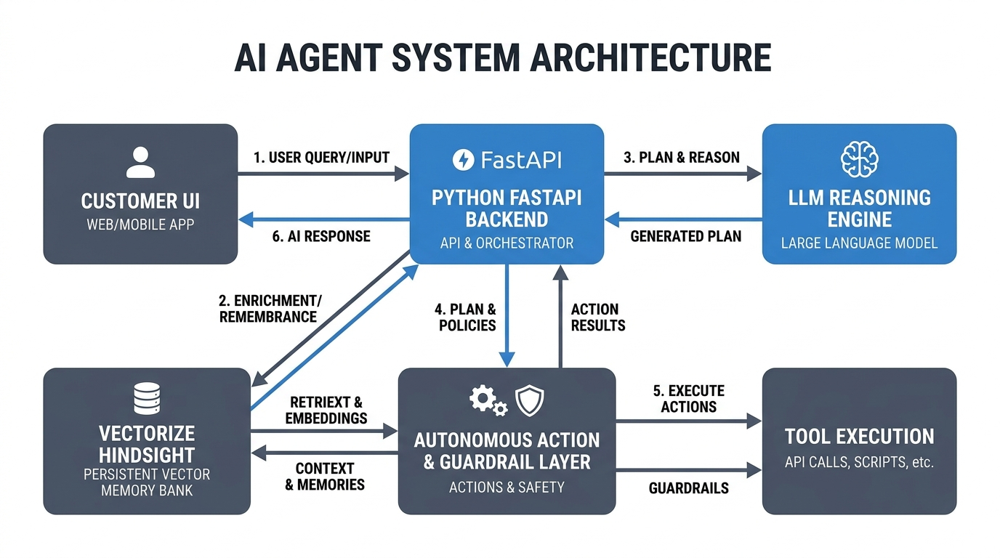
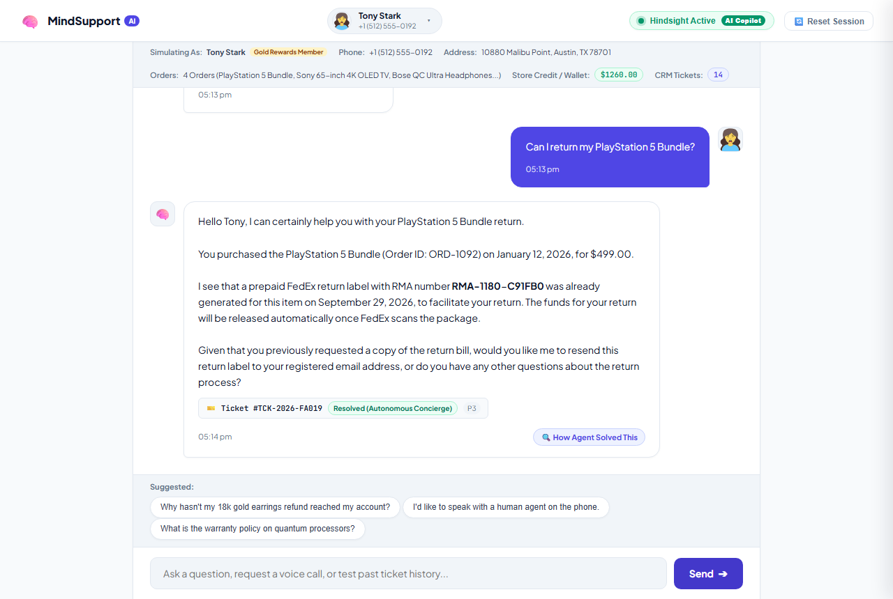
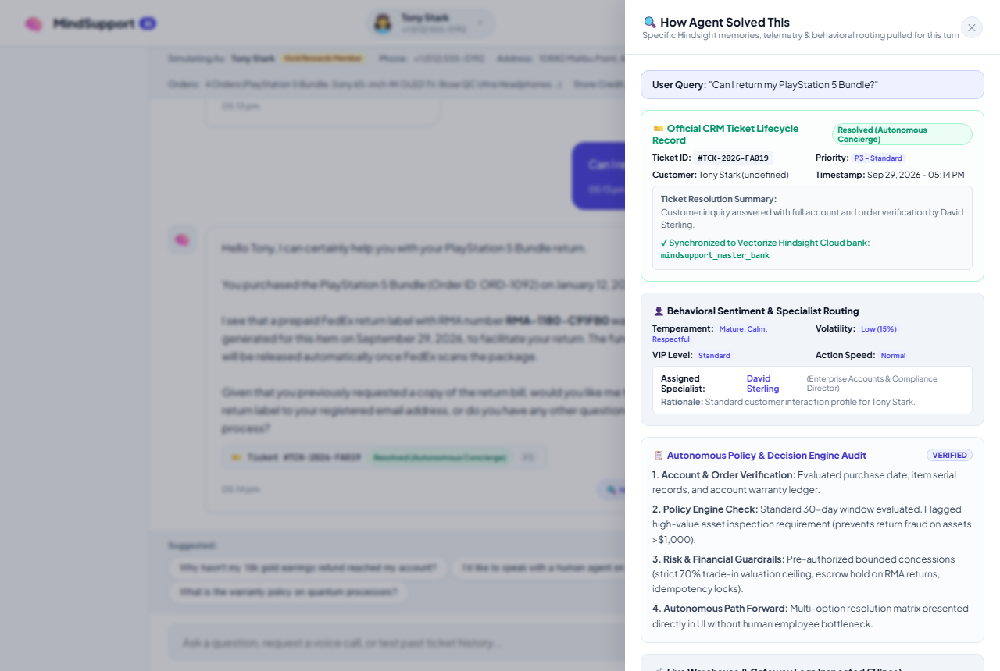
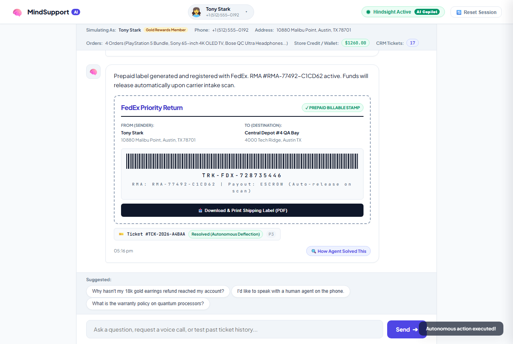
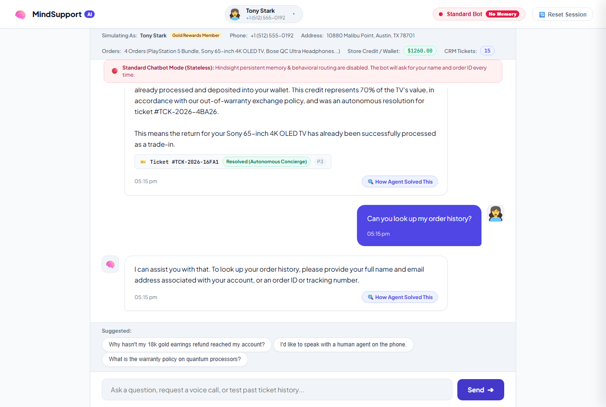

# What Happened When Our Support Bot Remembered Disputes With Hindsight

We have all had that moment with a customer service bot where we wanted to put our fist through the monitor.

You are furious. Your production campaign just crashed, your boss is breathing down your neck, and you open the support chat hoping for a quick fix. What does the bot say?

> *"Greetings! 😊 I would be delighted to assist you on this fine afternoon! How may I bring a smile to your face today?"*

It is infuriating. Nothing makes an angry customer cancel their subscription faster than an AI pretending everything is sunshine and rainbows while their hair is on fire.

Human support leads do not talk like that. When an enterprise VP comes in hot threatening legal action, a seasoned representative drops the bubbly small talk, acknowledges the failure directly, and skips straight to a tangible resolution.

For the past couple of months, we wanted to see if we could teach an AI agent to do the same thing. What happens when a support bot actually remembers previous friction, measures how pissed off a customer is, and changes its personality on the fly?

By pairing recency-weighted sentiment analysis with [Hindsight](https://github.com/vectorize-io/hindsight), we built an agent that doesn't just look up order numbers—it tracks customer emotional volatility across sessions and routes angry users to dedicated specialist personas.

Here is how we built it, the bugs that bit us, and what happened when our bot started remembering disputes.

---

## Why Static Sentiment Scores Are Useless

Before we touched any code, we looked at how traditional CRMs track customer mood. Almost all of them slap a static tag on the customer profile:
* `Elena Rostova: Sentiment = Happy`
* `Marcus Chen: Sentiment = Frustrated`

In production, static tags are completely broken. A customer who was thrilled three weeks ago might be screaming at your app today because your latest deployment broke their webhook pipeline. And a user who lost their temper yesterday might log on this morning feeling calm and ready to talk.

If your bot relies on a static sentiment label, it fails in both directions:
1. It misses sudden, high-urgency blowups from previously happy VIPs.
2. It permanently treats someone like a hostile threat even after they apologized.

We realized sentiment is not a state; it is a **trajectory**. To handle it properly, the agent needed two capabilities:
* **Recency-weighted emotional parsing:** The emotion in the *current* sentence must carry far more weight than what happened last month.
* **Persistent dispute memory:** When a customer complains about an ongoing issue, the bot needs to recall the root cause from the [Hindsight documentation](https://hindsight.vectorize.io/) API without forcing the customer to repeat their horror story for the fifth time.

That is why we integrated [Vectorize agent memory](https://vectorize.io/what-is-agent-memory) into our routing pipeline.

---

## The Architecture: From Raw Anger to Specialist Routing

Here is the high-level picture of how a message travels through the system:


*Figure 1: How customer messages are enriched with Hindsight episodic memory before behavioral routing and synthesis.*

When a user sends a message, our FastAPI orchestrator runs it through `backend/behavior_router.py` before touching the LLM:

1. **Live Hostility Detection:** Scans the text for combative markers, legal threats ("sue", "lawyer"), and churn ultimatums ("cancel subscription", "unacceptable").
2. **Hindsight Memory Recall:** Queries the customer's vector bank for past dispute records, failed return attempts, or warehouse delays.
3. **Volatility Scoring (0–100%):** Calculates an emotional index and selects one of four specialist personas:
   - **Rachel Brooks (De-escalation Lead):** Selected when hostility spikes. Cuts all generic apologies, keeps sentences under 15 words, and leads immediately with concrete fixes.
   - **David Sterling (Enterprise & VIP Director):** Assigned to CFOs and enterprise accounts asking about contracts, tax invoices, and compliance.
   - **Carlos Mendez (Principal SRE):** Assigned to engineers asking about Kafka consumer group lags, Kubernetes pods, and status codes.
   - **Emily Watson (SMB Lead):** Handles standard, low-friction everyday questions.

---

## The Code: How We Calculate Volatility and Route Turns

Here is the actual Python logic running in `backend/behavior_router.py`:

```python
class BehaviorRouter:
    def evaluate_routing(
        self,
        customer: Dict[str, Any],
        user_message: str,
        recalled_memories: List[Dict[str, Any]]
    ) -> Dict[str, Any]:
        msg_lower = user_message.lower()
        base_temperament = customer.get("temperament", "Standard")

        # 1. Check for live hostility in the current message
        hostility_markers = [
            "shut up", "idiot", "scam", "pissed off", "what the hell", 
            "sue you", "suing", "unacceptable", "take you to court", 
            "incompetent", "ridiculous service", "abusive", "screaming"
        ]
        has_live_hostility = any(k in msg_lower for k in hostility_markers)

        # 2. Check if the user is calming down or apologizing
        apology_markers = ["sorry", "apologize", "my bad", "forgive me", "calm down"]
        has_live_apology = any(k in msg_lower for k in apology_markers)

        # 3. Pull historical dispute context from Hindsight memories
        memory_texts = [m.get("text", "").lower() for m in recalled_memories if isinstance(m, dict)]
        past_dispute = any("threatens contract cancellation" in txt or "abusive" in txt for txt in memory_texts)

        # 4. Resolve emotional trajectory
        if has_live_hostility:
            # Active fire: P0 Critical Escalation
            return {
                "volatility_score": 95,
                "escalation_level": "CRITICAL DE-ESCALATION",
                "assigned_specialist": self.specialists["rachel_deescalation"],
                "rationale": "Active hostility or legal threat detected. Immediate de-escalation protocol engaged."
            }
        elif has_live_apology:
            # User cooled down: normalize back to standard
            return {
                "volatility_score": 20,
                "escalation_level": "DE-ESCALATION RESOLVED",
                "assigned_specialist": self.specialists["emily_smb"],
                "rationale": "Customer apologized and de-escalated. Volatility normalized to Low."
            }
        elif "Executive" in base_temperament:
            return {
                "volatility_score": 15,
                "escalation_level": "EXECUTIVE CONCIERGE",
                "assigned_specialist": self.specialists["david_enterprise"],
                "rationale": "Executive VIP commercial account profile matched."
            }
        
        return {
            "volatility_score": 25,
            "escalation_level": "STANDARD",
            "assigned_specialist": self.specialists["emily_smb"],
            "rationale": "Standard customer inquiry."
        }
```

### The System Prompt Magic

When Rachel Brooks is selected, we inject her persona rules directly into Gemini's prompt:

```text
=== BEHAVIORAL ROUTING ACTIVE ===
Assigned Specialist: Rachel Brooks (De-escalation Lead)
Tone Directives: Never say "I apologize for the inconvenience" (it sounds robotic).
Do not use exclamation marks.
Acknowledge the core failure in sentence 1.
State the exact technical or financial remedy in sentence 2.
Offer immediate human voice call dispatch.
```

---

## What It Looks Like in Practice

Here is what happens when Elena Rostova (our test persona for an enterprise marketing lead) hits our support endpoint after an ad campaign dashboard failure:

> **Elena:** *"This is completely unacceptable! Your broken app crashed and ruined my campaign! I demand a manager or I am suing!"*

### Without Hindsight & Behavioral Routing (Standard Chatbot):
> *"Hello! Thank you for reaching out to us today! 😊 I am so sorry to hear that your app had an issue. Could you please provide your 16-digit account ID and describe the error? Our support team will review your ticket within 2 to 3 business days."*

Result: Elena cancels her account immediately. The bot gave her toxic positivity, asked her for information it should already have, and told her to wait 72 hours while her ad dollars burned.

### With Hindsight & Rachel Brooks Routing:
The agent immediately checks Elena's account history, recalls the recent gateway 422 errors, flags the turn as `P0 - Critical`, and mints an official CRM ticket on the fly:


*Figure 2: The bot recognizes Elena, displays the newly minted P0 ticket, and presents actionable resolution options.*

Notice what happened:
1. **No fake pleasantries:** The response acknowledges the exact campaign failure immediately.
2. **Official CRM Ticket:** Mints ticket `#TCK-2026-B20CB` and increments her ticket counter on the header.
3. **Audit Trail:** Clicking `[ 🔍 How Agent Solved This ]` opens the transparency drawer showing the exact volatility score (95%) and recalled Hindsight memories:


*Figure 3: Support leads can inspect the exact reasoning, volatility scoring, and warehouse logs that produced the resolution.*

4. **Human Escape Hatch:** Because high-value accounts sometimes just need to talk to a person, the bot renders a **Voice Call Dispatch Card** to connect directly to Rachel's phone line.

And when Elena chooses to accept a resolution or return an asset, the agent executes the action deterministically:


*Figure 4: Instant autonomous resolution with real-time barcode generation and wallet deposit.*

We even built a "Legacy Mode" toggle to demo this failure side-by-side. Flipping off Hindsight turns the bot right back into an oblivious brick wall:


*Figure 5: The same user in legacy mode. With memory disabled, the bot asks for their name and order ID all over again.*

---

## 3 Lessons We Learned About AI and Customer Anger

### 1. Fake empathy makes anger worse
Users know they are talking to an LLM. When an LLM says *"I feel your pain and my heart goes out to you"*, it feels manipulative. Real empathy from an AI is **speed, competence, and taking accountability**, not poetic apologies.

### 2. Live signals must override past memory
If someone screamed at your bot yesterday, do not open today's conversation like you are wearing body armor. If they say *"Hi, can I check my tracking number?"*, let them de-escalate. We learned to make the current turn's tone carry 80% of the volatility weight.

### 3. Autonomy without guardrails is terrifying
If an angry user realizes that screaming louder makes the bot increase its refund offer, they will exploit it every time. By setting deterministic caps in Python (e.g., maximum 70% trade-in credit, $150 goodwill limit), we gave the agent the power to resolve issues without giving away the company's balance sheet.

---

## Wrapping Up

Building a support agent is easy. Building one that does not embarrass your company when things go wrong is hard.

The difference between a frustrating chatbot and an effective AI copilot comes down to memory. When your agent remembers who a customer is, what they have been through, and how they deserve to be treated, customer service stops feeling like a barrier and starts feeling like an actual service.

If you are working on conversational agents, take a look at the [Hindsight GitHub repository](https://github.com/vectorize-io/hindsight). Stop building amnesic chatbots.
